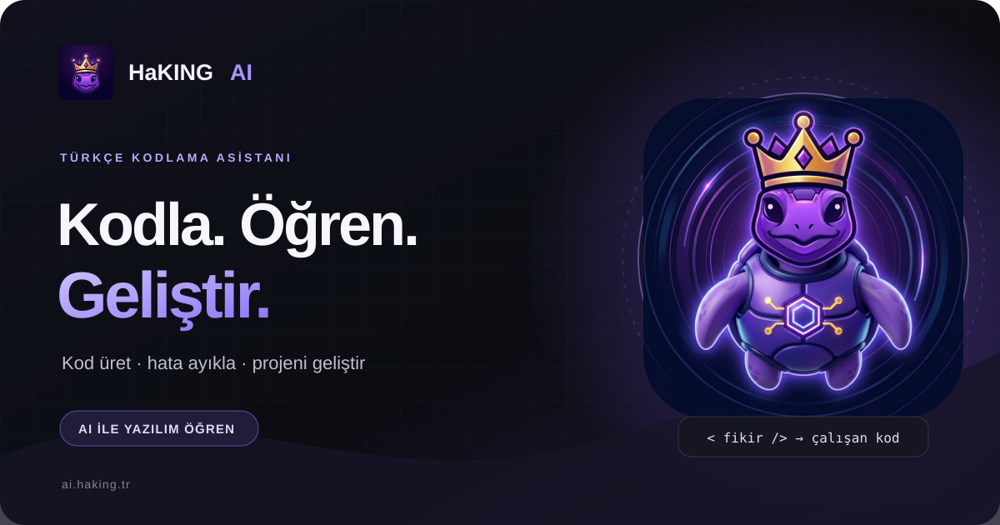

# HaKING AI — Ön yüz

HaKING AI; kod yazma, kodu açıklama ve hata ayıklama için Türkçe sohbet sunan statik bir web uygulamasıdır. Bu depo, Cloudflare Workers üzerinde yayınlanan ön yüzü içerir. Güncel sürüm: **1.0.4**.

## Teknoloji ve yayınlama

- HTML, CSS ve tarayıcı JavaScript'i; kullanıcı arayüzü için ek bir uygulama çatısı kullanılmaz.
- Dağıtım ve statik dosyalar Cloudflare Workers ile sunulur.
- Giriş, kayıt, e-posta doğrulama, ayarlar, kredi ve sohbet API'leri Render'daki ayrı backend servisini kullanır.
- Yerel geliştirme: `npm run dev`
- Yayın öncesi derleme kontrolü: `npm run build` (Wrangler dry-run; yayın yapmaz)
- Yayınlama: `npm run deploy`

Cloudflare yapılandırmasında depo kök dizini `/`, derleme komutu `npm run build`, dağıtım komutu `npx wrangler deploy` olmalıdır. `robots.txt` ve `sitemap.xml` kök dizinden sunulur.

## Özellikler

- E-posta doğrulamalı kayıt, giriş, parola sıfırlama ve hesap silme akışları.
- Groq ve Google Gemini sağlayıcılarına yönlendirilen sohbet; yanıtlar akış halinde gösterilir.
- Normal sohbet ve önce proje brief'i hazırlayıp ardından yanıt üreten, kredi kullanan Çılgın Mod.
- Uygun yeni proje isteklerinde Tavily ile web araştırması; yanıt altında kullanılan hizmetlerin ve varsa kaynakların gösterilmesi.
- Kod bloklarında kopyalama ve indirme; tek HTML dosyasını güvenli, yalıtılmış önizlemede açma; çok dosyalı yanıtları dosya sekmeleri ve ZIP olarak sunma.
- Metin/kod dosyası ekleyerek içerik inceletme. Dosyalar tarayıcıda okunur; uygulama dosyaları çalıştırmaz veya kalıcı olarak saklamaz.
- Sohbet geçmişini hesap bazında tarayıcının `localStorage` alanında tutma; ayarlar ve kredi bakiyesi görünümü.
- Zorunlu tarayıcı depolaması için çerez tercihi açıklaması; şu an analiz ve reklam izleyicisi kullanılmaz.
- Mobil uyumlu koyu arayüz, gizlilik/hakkında sayfaları ve HaKING marka varlıkları.
- Herkese açık `download.html` sayfasında HaKING AI Desktop ZIP paketi, sistem gereksinimleri, kurulum, veri kaynağı, çevrimdışı kapsam ve güvenlik açıklamaları.

## Yanıt akışı ve hız

Sohbet, backend'den Server-Sent Events (SSE) akışı alır. Uzun yanıtlar boyunca Markdown'ı her gelen küçük parçada yeniden işlemek pahalı olduğundan, yanıt uzadıkça ekrandaki yeniden çizim sıklığı kademeli azaltılır; tamamlandığında son içerik hemen işlenir. Bu, uzun kod yanıtlarında tarayıcı tarafındaki gereksiz işi azaltır. Modelin üretim süresini, sağlayıcı kotasını veya Render'ın ücretsiz plandaki soğuk başlangıçlarını ortadan kaldırmaz.

Çılgın Mod'daki aşama göstergeleri işlemin hangi adımda olduğunu bildirir; modelin özel düşünme içeriğini göstermez. Yeni proje isteğinde araştırma açıksa Tavily kısa kaynak parçalarını brief aşamasına ekler. Kısa bilgi soruları ve mevcut kodu düzeltme istekleri proje araştırması akışına yönlendirilmez.

## Gizlilik ve güvenlik

- Backend anahtarlarını (`GROQ_API_KEY`, `GEMINI_API_KEY`, isteğe bağlı `TAVILY_API_KEY`, `RESEND_API_KEY`, veritabanı adresleri ve imzalama sırları) yalnızca özel Render ortam değişkenlerinde saklayın. Bu depoya veya Cloudflare ön yüz değişkenlerine koymayın.
- Oturum belirteci ve hesap bazlı sohbet geçmişi tarayıcı `localStorage` alanında tutulur; sohbet metni uygulama veritabanında arşivlenmez. Mesajlar yanıt üretmek için backend'e ve seçilen AI sağlayıcısına iletilir; yedek sağlayıcıya geçişte aynı istek ona da gönderilebilir.
- Sohbet eki olarak tek bir izinli metin/kod dosyası, en fazla 64 KiB olacak şekilde gönderilebilir. Gizli anahtar algılama sınırlı bir önlemdir; dosyaya parola, API anahtarı veya paylaşılmaması gereken veri koymayın.
- Üretilen HTML önizlemesi yalıtılmış iframe içinde çalıştırılır. Üretilen kodu indirmeden/çalıştırmadan önce inceleyin.
- Gizlilik sayfası sağlayıcıları ve mevcut veri akışlarını açıklar. Dağıtım ortamındaki gerçek yapılandırmayla belgeleri eşleşir tutun.

Backend'in yapılandırma ve yayınlama ayrıntıları backend deposundaki README'de yer alır. Güvenlik bildirimi için [`SECURITY.md`](./SECURITY.md), katkı kuralları için [`CONTRIBUTING.md`](./CONTRIBUTING.md), sürüm notları için [`CHANGELOG.md`](./CHANGELOG.md) dosyalarını inceleyin.

## Marka varlıkları

Güncel kimlik; taçlı mor kaplumbağa maskotunu, site simgelerini, sosyal medya görsellerini ve kredi paketi afişlerini içerir. Küçük arayüz simgelerinde maskotun sade baş görseli, büyük tanıtım çalışmalarında tam gövde görseli kullanılır. Paket fiyatı veya içeriği değişirse ilgili afişleri de güncelleyin. Kullanım notları `assets/brand/BRAND-GUIDE.md` dosyasındadır.

## Sürümleme

Güncel sürüm `1.0.4`'dir. Önceki sürümler yalnızca [`CHANGELOG.md`](./CHANGELOG.md) içinde yer alır. Sürüm numarasını `package.json`, `package-lock.json`, HTML varlık sürüm etiketleri ve uygulama bilgi ekranıyla eşleştirin.
